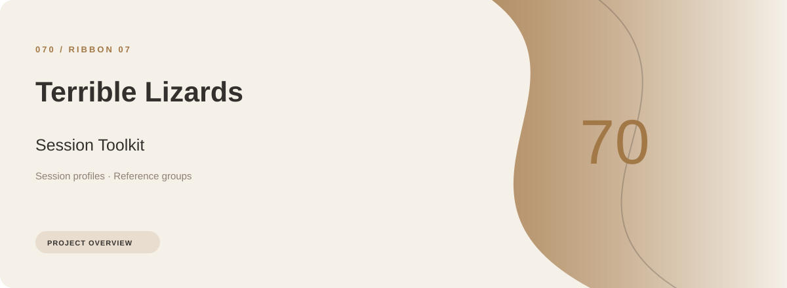
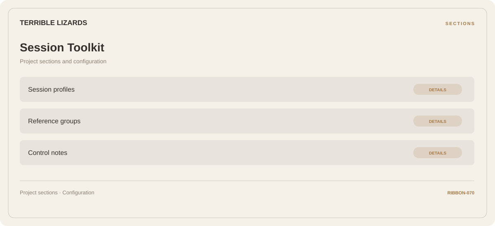

# ⚡ Terrible Lizards Session Toolkit

**Session profiles · Reference groups · Control notes**

## ⚡ Features

A task-oriented Terrible Lizards session toolkit workspace: session profiles first, reference groups next, and control notes as the final reference area.

### ⚙️ Session profiles

Related settings collected into named groups for a clearer configuration workflow.

### 🧩 Reference groups

A dedicated section for reference groups and the configuration details associated with that area.

### ⌨️ Control notes

A dedicated section for control notes and the configuration details associated with that area.

## 🖥️ Project navigation

## 📥 Download

The button and cover open the project's download page. Use the information supplied with the downloaded package for installation and release-specific requirements.

## 📚 Project documentation

- [Feature reference](docs/FEATURES.md)
- [Download information](docs/DOWNLOAD.md)
- [Project page](index.html)

---

Terrible Lizards Session Toolkit · Program documentation and download information.
                                                                                                    